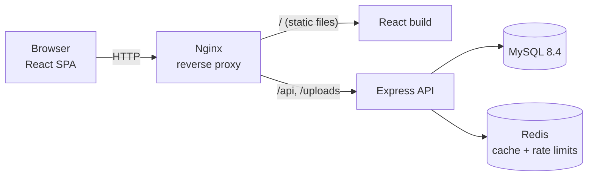
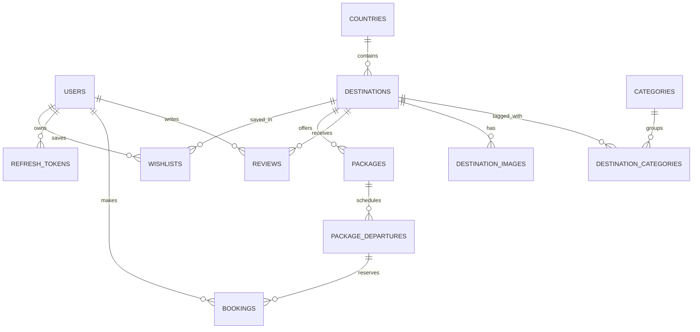

<div align="center">

# 🌍 Wanderly: Travel Destination Management Platform

**Discover, review and book travel destinations.**
A full-stack application built with production practices: secure auth, advanced SQL, concurrency-safe bookings, caching, tests and CI.

[](https://github.com/murleework07/travel-destination-platform/actions/workflows/ci.yml)


</div>

---

## 📸 Screenshots

| Home | Explore (search, filters, infinite scroll) |
|---|---|
|  |  |

| Destination details & reviews | Admin dashboard |
|---|---|
|  |  |

---

## ✨ Features

### For travellers
- 🔎 **Search** with MySQL **full-text search**, filters (country, categories, rating, budget), sorting and **infinite scroll**
- 🏝️ Destination pages with a photo gallery, rating breakdown and paginated reviews
- 🎟️ **Book seats** on dated departures; view and cancel bookings
- ⭐ One review per destination; ratings update everywhere instantly
- 🔐 Sign up and log in; the session survives page reloads through a secure refresh cookie

### For admins
- 📊 **Dashboard:** revenue by month, reviews by country, Bayesian top-rated ranking, best destination per country, top packages and reviewers
- 🗺️ Create, edit and soft-delete destinations; **upload photos** with type, size and magic-byte validation
- 👥 Manage user roles

---

## 🛠️ Tech stack

| Layer | Technologies |
|---|---|
| **Frontend** | React 19, Vite, React Router, TanStack Query, Axios, Tailwind CSS v4, Recharts |
| **Backend** | Node.js, Express 5, Zod validation, JWT, bcrypt, Multer, Pino logging, Swagger / OpenAPI 3 |
| **Database** | MySQL 8.4: InnoDB, foreign keys, CHECK constraints, FULLTEXT index, CTEs, window functions |
| **Cache** | Redis: cache-aside and rate limiting |
| **Testing** | Vitest, Supertest (integration tests against a real MySQL database) |
| **DevOps** | Docker (multi-stage builds), Nginx reverse proxy, Docker Compose, GitHub Actions CI |

---

## 🏗️ Architecture



The API uses a **layered architecture**, where each layer has one job:

```
routes → controllers → services → repositories → MySQL
(URLs,    (HTTP request/  (business rules,   (SQL only)
 auth,     response)       transactions)
 validation)
```

---

## 🗄️ Database design

A normalized (3NF) schema with **12 tables**, foreign keys, `UNIQUE` and `CHECK` constraints, composite and FULLTEXT indexes, and soft deletes.



---

## 🔑 Engineering highlights

| Problem | Solution |
|---|---|
| **Overbooking** when many users book the last seats at once | Transaction + `SELECT … FOR UPDATE` row lock, consistent lock ordering to avoid deadlocks, and a `CHECK (booked_seats <= total_seats)` safety net. An automated test fires **25 parallel requests at 5 seats, and exactly 5 succeed.** |
| **Duplicate bookings** from double clicks or network retries | `Idempotency-Key` header + `UNIQUE (user_id, idempotency_key)`; a retry returns the original booking |
| **Stolen session tokens** | 15-minute JWT access token kept in memory + rotating refresh token in an `httpOnly`, `SameSite=Strict` cookie, stored as a SHA-256 hash. **Reusing an old refresh token revokes every session.** |
| **Slow deep pagination** | **Keyset (cursor) pagination** that uses indexes instead of `OFFSET`; checked with `EXPLAIN ANALYZE` |
| **Slow text search** | **FULLTEXT** index in boolean mode instead of `LIKE '%…%'` (which can't use an index) |
| **Correct average ratings under concurrency** | Denormalized `avg_rating` / `review_count`, recalculated inside a row-locked transaction |
| **Database load from popular pages** | Redis **cache-aside** with **O(1) versioned invalidation** and TTL jitter against cache stampedes |
| **Brute-force login attempts** | Redis **rate limiting** (atomic Lua script) per IP + email, counting only failed attempts |
| **Bad input** | Zod schemas on params, query and body; parameterized SQL everywhere; column whitelists for dynamic updates |
| **Debugging in production** | Structured JSON logs (Pino) with **request IDs** returned to clients, and secrets redacted |

**Advanced SQL used in reports:** CTEs (`WITH`), window functions (`ROW_NUMBER() OVER (PARTITION BY …)`), `GROUP BY … HAVING`, conditional aggregation (`SUM(CASE …)`), `LEFT JOIN` aggregates and a Bayesian weighted rating (the IMDb Top 250 formula).

---

## 🚀 Getting started

**Requirements:** [Node.js 22+](https://nodejs.org) and [Docker Desktop](https://www.docker.com/products/docker-desktop/)

```bash
git clone https://github.com/murleework07/travel-destination-platform.git
cd travel-destination-platform
cp server/.env.example server/.env
```

Open `server/.env` and set `JWT_ACCESS_SECRET` to a long random string:

```bash
node -e "console.log(require('crypto').randomBytes(64).toString('hex'))"
```

### Option 1: run everything in Docker

```bash
docker compose --profile full up -d --build
```

Open **http://localhost:8080**. API docs: **http://localhost:8080/api/docs**

### Option 2: development mode with hot reload

```bash
docker compose up -d       # MySQL + Redis (tables and sample data are created automatically)
npm run install:all        # installs root, server and client dependencies
npm run dev                # API on :5000 and web app on :5173
```

Open **http://localhost:5173**. API docs: **http://localhost:5000/api/docs**

### Create an admin account

```bash
cd server
npm run create-admin -- --email admin@example.com --password "ChooseAStrongPassword1" --name "Admin"
```

---

## 🧪 Testing

```bash
cd server
npm test                   # unit + integration tests against a real MySQL test database
npm run test:coverage      # with a coverage report
npm run loadtest:booking   # fires 50 simultaneous bookings at 5 seats (server must be running)
```

The tests cover authentication (refresh rotation, reuse detection, no user enumeration, tampered tokens), role-based access, validation, search and cursor pagination, review consistency under concurrency, idempotency, IDOR protection and the no-overbooking guarantee.

**GitHub Actions** runs the backend tests against MySQL, builds the frontend and builds both Docker images on every push.

---

## 📚 API overview

Interactive OpenAPI documentation is available at **`/api/docs`** when the server is running.

| Area | Endpoints |
|---|---|
| Auth | `POST /auth/register`, `/auth/login`, `/auth/refresh`, `/auth/logout` · `GET /auth/me` |
| Destinations | `GET /destinations` (search, filters, cursor pagination) · `GET /destinations/:slug` · admin `POST`, `PATCH`, `DELETE` · `POST /destinations/:id/images` |
| Reviews | `GET /destinations/:slug/reviews` · `GET /destinations/:slug/rating-summary` · `POST /destinations/:id/reviews` · `PATCH`/`DELETE /reviews/:id` |
| Bookings | `GET /packages/:id` · `POST /bookings` (Idempotency-Key) · `GET /bookings/me` · `POST /bookings/:id/cancel` |
| Admin | `GET /users` · `PATCH /users/:id/role` · `GET /reports/top-rated`, `/country-stats`, `/best-per-country`, `/top-reviewers`, `/bookings` |
| Health | `GET /health` (database + cache status) |

---

## 📁 Project structure

```
├── client/                  React app (Vite)
│   ├── src/
│   │   ├── api/             Axios client (silent token refresh), API modules
│   │   ├── components/      Layout, cards, forms, route guards
│   │   ├── context/         Auth context
│   │   ├── hooks/           useDebounce, useInfiniteScroll
│   │   └── pages/           Home, Explore, Destination, Package, My Bookings, admin/
│   ├── Dockerfile           Build → served by Nginx
│   └── nginx.conf
├── server/                  Express API
│   ├── database/            schema.sql, seed.sql
│   ├── src/
│   │   ├── config/          env, MySQL pool, Redis
│   │   ├── routes/          URL → middleware → controller
│   │   ├── controllers/     HTTP layer
│   │   ├── services/        Business logic and transactions
│   │   ├── repositories/    SQL queries
│   │   ├── middlewares/     auth, RBAC, validation, rate limiting, uploads, errors
│   │   ├── validators/      Zod schemas
│   │   └── docs/            OpenAPI spec
│   ├── tests/               Vitest + Supertest
│   └── Dockerfile
├── docker-compose.yml
└── .github/workflows/ci.yml
```

---

## 🔭 Future improvements

- Store images in S3 with presigned uploads
- Payment integration (Stripe), reusing the existing idempotency design
- Wishlist UI (the table already exists) and email notifications through a job queue
- Cloud deployment with HTTPS

---

<div align="center">

Built by **Murlee Manoher Verma**

</div>
